# Awesome-3D-Rigging-Animation-Automation 🚀

<p align="center">
  
</p>

<p align="center">
  <a href="https://github.com/ishandutta2007/Awesome-Awesome-Awesome"></a>
  <a href="https://discord.gg/jc4xtF58Ve"></a>
  <a href="https://github.com/ishandutta2007/Awesome-3D-Rigging-Animation-Automation/stargazers"></a>
  <a href="https://github.com/ishandutta2007/Awesome-3D-Rigging-Animation-Automation/network/members"></a>
  <a href="https://github.com/ishandutta2007/Awesome-3D-Rigging-Animation-Automation/issues"></a>
  <a href="https://github.com/ishandutta2007/Awesome-3D-Rigging-Animation-Automation/blob/main/LICENSE"></a>
  <a href="https://github.com/ishandutta2007"></a>
</p>

---

## 📖 Top 3D Rigging & Animation Automation Ecosystem

> **A Curated Directory of SaaS Platforms & Open-Source Projects for Automated 3D Character Rigging, AI Motion Capture, Text-to-Animation Pipelines, and Headless Skeleton Binding Workflows.**

**Last updated:** November 2026 🗓️

Welcome to **Awesome-3D-Rigging-Animation-Automation**! This comprehensive, SEO-optimized repository tracks notable **SaaS platforms** and **open-source repositories** revolutionizing 3D character rigging, neural skeletal binding, automated weight painting, and markerless video/text-to-animation pipelines. Whether you are building real-time avatar pipelines for games (Unity, Unreal Engine 5, Godot), headless Blender VFX batch jobs, or procedural WebGL/Three.js web apps, this directory indexes state-of-the-art tools across the industry.

---

## 📑 Table of Contents
- [📊 Sector Overview & Market Dynamics](#-sector-overview--market-dynamics)
- [☁️ SaaS & Hosted Platforms](#️-saas--hosted-platforms)
- [💻 Open-Source GitHub Projects](#-open-source-github-projects)
- [🛠️ Pipeline Architecture & Integration Guide](#️-pipeline-architecture--integration-guide)
- [🤝 How to Contribute](#-how-to-contribute)
- [⭐ Star History](#-star-history)
- [💖 Support & Sponsorship](#-support--sponsorship)
- [⚖️ Disclaimer](#️-disclaimer)

---

## 📊 Sector Overview & Market Dynamics

The global **3D animation software market** is estimated at **$18.3 billion in 2026** (expanding at an ~11% CAGR toward $31 billion by the 2030s), while the specialized **3D motion capture and auto-rigging market** is valued at **$318 million to $387 million** in 2026, growing at a rapid 12.5% to 13.5% CAGR driven by real-time virtual production, indie game engines, and markerless generative AI.

The sector demonstrates **moderate market fragmentation**: foundational digital content creation suites and enterprise IP remain concentrated within incumbent tech giants (e.g., Adobe and Autodesk with $50B–$95B valuations), while the fast-moving auto-rigging, AI video-to-mocap, and diffusion-based text-to-animation layers remain highly dynamic and fragmented among specialized venture-backed startups and open-source research breakthroughs.

---

## ☁️ SaaS & Hosted Platforms

Below is a structured comparison of the top commercial and hosted cloud platforms for automated 3D rigging and motion capture. Products are **ranked descending by company scale (market capitalization, valuation, or total capital backed)**.

| SaaS Product 🏷️ | Company Scale / Valuation 🏢 | Starting Price 💳 | Free Tier / Trial Limits 🎁 | Core Specialization 🎯 |
| :--- | :--- | :--- | :--- | :--- |
| **[Adobe Mixamo](https://mixamo.com)** | **~$91B – $95B** *(Public: NASDAQ: ADBE)* | **$0 / Free** (Included with Adobe ID) | **100% Free Forever**: Unlimited auto-rigs for humanoid bipeds (OBJ/FBX) and unrestricted downloads across thousands of royalty-free mocap animation clips. Personal & commercial use included. | Cloud automated biped skeleton placement, heat skinning, and extensive pre-baked mocap animation library. |
| **[Wonder Dynamics (Autodesk Flow Studio)](https://wonderdynamics.com)** | **~$53B – $56B** *(Acquired by Autodesk, NASDAQ: ADSK)* | **$10.00 / month** (Lite plan, billed annually) | **Free Forever Tier**: 300 credits/month (approx. 15s live-action render or 30s AI mocap); limited to 720p watermarked video outputs and 1 GB cloud storage; non-commercial license. | Markerless single-camera AI performance capture, automatic 3D character replacement, clean lighting integration, and clean alpha plate generation. |
| **[Reallusion ActorCore (AccuRIG)](https://actorcore.reallusion.com)** | **~$9.5M – $10M** *(Public: TPEx: 6882)* | **$0 for AccuRIG software**; motion subscriptions start at **$29.00 / month** (or single motion clips from $1.50) | **100% Free AccuRIG Desktop Application**: Full bone alignment, manual joint adjustment, hand/finger binding, and FBX/USD export to Unreal, Unity, and Blender with zero commercial royalties. ActorCore web features a permanent rotation of free sample animations. | High-fidelity humanoid bone mapping, automated finger rigging, and production-grade export presets for AAA engines. |
| **[Cascadeur](https://cascadeur.com)** | **$1.5M+ Dedicated Dev Budget** *(Internal division of Nekki / Epic MegaGrant recipient)* | **$6.00 – $19.00 / month** (Indie tier for creators/studios earning <$100K/year) | **Free Forever Tier**: Full access to physics-based AI autoposing, secondary motion simulation, ballistic trajectory calculation, and character rigging tools. Strictly non-commercial and limited to proprietary `.casc` file exports (no FBX/DAE export). | AI-assisted and physics-guided 3D character keyframe animation, center-of-mass trajectory editing, and automatic balance constraints. |
| **[Rokoko Studio](https://rokoko.com)** | **$80M+ Valuation** *(Raised $17.5M+ across venture & strategic rounds)* | **$10.00 – $12.00 / month** (Basic AI mocap tier) | **Free Forever Starter Plan**: Unlimited hardware recordings, real-time viewport filters, FBX recording exports, 30 seconds/month of Rokoko Vision AI video-to-mocap, and 5 text-to-motion Studio imports/month. | Hybrid inertial sensor suit integration, smart gloves, facial tracking, and browser-based AI video-to-skeleton tracking. |
| **[Move.ai](https://move.ai)** | **$17.5M Venture Funding** *(Acquired by Oxford Metrics / Vicon)* | **$15.00 / month** (Move One Personal plan) | **Free Tier (One-time credit grant)**: 30 credits given upon sign-up (does not expire; approx. 30 seconds of mocap extraction); strictly non-commercial and capped at 30 seconds per video capture. | Multi-camera studio mocap and single-camera iPhone markerless capture delivering clean biomechanical skeletal tracks. |
| **[Kinetix](https://kinetix.tech)** | **$11M Venture Funding** *(Backed by Top Tier Web3 & Gaming VCs)* | **Pay-As-You-Go (~€0.15 / generation)** or Custom B2B Enterprise SDK | **Developer Free Tier**: Up to 10,000 free generative animation API calls / emote triggers for games integrating the Kinetix SDK; restricted to non-commercial testing for indie studios. | AI video-to-3D emote and dance synthesis engine, SDK integration for user-generated content in virtual worlds and games. |
| **[Anything World](https://anything.world)** | **$9.3M Venture Funding** *(Backed by Warner Music Group & Acrew Capital)* | **$30.00 / month** (Nano Tier, includes 100 generation credits) | **Free Forever Tier**: 15 credits per month for auto-rigging, text-to-3D animation, and model rigging; limited to 1 downloadable 3D asset export per month for teams earning under $100K. | Automated skeleton binding and locomotion generation for humanoids, quadrupeds, birds, fish, and fantasy creatures. |
| **[DeepMotion](https://deepmotion.com)** | **$2.2M+ Venture Funding** *(Backed by Bandai Namco 021 Fund & Redpoint)* | **$9.00 – $15.00 / month** (Starter plan with commercial rights & 180 credits) | **Free Forever Freemium Tier**: 60 credits (seconds) per month; maximum 20 seconds per individual video clip; non-commercial license with watermarked preview exports. Additional credits can be earned via Community Pose Correction. | Cloud markerless 2D video-to-3D animation extraction with full-body physics, finger kinematics, and face tracking. |
| **[Plask](https://plask.ai)** | **$2.6M Pre-Series A** *(Backed by Smilegate & Naver)* | **$18.00 / month** (Standard plan billed annually) | **Free Forever Tier**: 15 seconds of AI mocap processing daily; 1 GB of cloud asset storage; web-based keyframe editor with basic humanoid retargeting exports. | Browser-based AI motion capture extraction and keyframe editing workspace built for animators and web creators. |

---

## 💻 Open-Source GitHub Projects

Explore the leading open-source libraries, autonomous auto-riggers, deep-learning models, and motion capture toolkits. Repositories are **ranked descending by GitHub stargazers count** with live stargazer social badges.

| Repository & Creator 📦 | Stars 🌟 | Primary License ⚖️ | Tech Stack 🛠️ | Description & Architectural Highlights 🔍 |
| :--- | :--- | :--- | :--- | :--- |
| **[CMU-Perceptual-Computing-Lab/openpose](https://github.com/CMU-Perceptual-Computing-Lab/openpose)** | [](https://github.com/CMU-Perceptual-Computing-Lab/openpose/stargazers) | Non-commercial / Research | C++, CUDA, Python | The landmark multi-person 2D/3D keypoint detection framework powering body, foot, hand, and facial motion capture pipelines worldwide. |
| **[blender/blender](https://github.com/blender/blender)** | [](https://github.com/blender/blender/stargazers) | GPL-2.0+ | C, C++, Python | The flagship open-source 3D production suite featuring **Rigify**, Bendy Bones, automatic heat-weight skinning, IK/FK solvers, NLA clip blending, and headless CLI scripting. |
| **[freemocap/freemocap](https://github.com/freemocap/freemocap)** | [](https://github.com/freemocap/freemocap/stargazers) | AGPL-3.0 | Python, OpenCV, MediaPipe | Free, open-source markerless multi-camera motion capture system converting standard webcam and smartphone video arrays into synchronized 3D skeletal data. |
| **[open-mmlab/mmpose](https://github.com/open-mmlab/mmpose)** | [](https://github.com/open-mmlab/mmpose/stargazers) | Apache-2.0 | PyTorch, Python | Comprehensive open-source toolbox for 2D/3D human and whole-body pose estimation, skeleton tracking, and motion synthesis benchmarks. |
| **[Mesh2Motion/mesh2motion-app](https://github.com/Mesh2Motion/mesh2motion-app)** | [](https://github.com/Mesh2Motion/mesh2motion-app/stargazers) | MIT | TypeScript, Three.js, WebGL | Free open-source browser and desktop Mixamo alternative for automated 3D mesh rigging, automatic skin weighting, and retargeting 40+ locomotion cycles onto bipeds and creatures. |
| **[mkocabas/VIBE](https://github.com/mkocabas/VIBE)** | [](https://github.com/mkocabas/VIBE/stargazers) | MIT | PyTorch, SMPL | Video Inference for Human Body Pose and Shape Estimation using adversarial learning to extract temporally coherent 3D character poses directly from monocular video. |
| **[vchoutas/smplx](https://github.com/vchoutas/smplx)** | [](https://github.com/vchoutas/smplx/stargazers) | Software Copyright / Research | PyTorch, NumPy | Expressive 3D human body model capturing joint kinematics, expressive face blendshapes, and realistic articulated hand/finger poses in unified meshes. |
| **[VAST-AI-Research/UniRig](https://github.com/VAST-AI-Research/UniRig)** | [](https://github.com/VAST-AI-Research/UniRig/stargazers) | Apache-2.0 | PyTorch, CUDA, Python | *SIGGRAPH 2025* unified auto-rigging architecture using autoregressive transformers to predict hierarchical skeleton trees and per-vertex skinning weights for arbitrary 3D meshes. |
| **[MaxLiu22/Motion2MixamoRig](https://github.com/MaxLiu22/Motion2MixamoRig)** | [](https://github.com/MaxLiu22/Motion2MixamoRig/stargazers) | Apache-2.0 | Python, Blender API | Automated Python pipeline and Blender add-on extracting human motion kinematics from video and retargeting animations directly onto any Adobe Mixamo character rig. |
| **[shubham-goel/4D-Humans](https://github.com/shubham-goel/4D-Humans)** | [](https://github.com/shubham-goel/4D-Humans/stargazers) | Research / CC-BY-NC | PyTorch, HMR 2.0 | State-of-the-art 3D human reconstruction and tracking system from monocular video using Transformer-based HMR 2.0 for robust animation retargeting in complex scenes. |
| **[akanazawa/hmr](https://github.com/akanazawa/hmr)** | [](https://github.com/akanazawa/hmr/stargazers) | MIT | TensorFlow, Python | End-to-end adversarial framework for estimating 3D human pose and 3D mesh surface geometry from a single RGB image without 3D ground-truth supervision. |
| **[Arthur151/ROMP](https://github.com/Arthur151/ROMP)** | [ | Apache-2.0 | PyTorch, ONNX | Real-time monocular multi-person 3D mesh recovery and skeleton extraction running efficiently on local consumer hardware and edge devices. |
| **[zhan-xu/RigNet](https://github.com/zhan-xu/RigNet)** | [](https://github.com/zhan-xu/RigNet/stargazers) | MIT | PyTorch, C++ | *SIGGRAPH 2020* pioneering neural network for automated skeleton generation and vertex skinning weight prediction on arbitrary articulated 3D character meshes. |
| **[facebookresearch/fairmotion](https://github.com/facebookresearch/fairmotion)** | [](https://github.com/facebookresearch/fairmotion/stargazers) | MIT | Python, PyTorch | Meta AI platform for loading, processing, visualizing, and training deep reinforcement learning models on raw BVH, AMASS, and mocap skeleton trajectories. |
| **[akanazawa/human_dynamics](https://github.com/akanazawa/human_dynamics)** | [](https://github.com/akanazawa/human_dynamics/stargazers) | Research / CC-BY-NC | TensorFlow, Python | Learning 3D human dynamics from video to predict future skeletal poses, camera motion, and velocity vectors across extended character animation clips. |
| **[blendi-remade/prompt2rig](https://github.com/blendi-remade/prompt2rig)** | [](https://github.com/blendi-remade/prompt2rig/stargazers) | Apache-2.0 | Python, GVHMR, WiLoR | End-to-end prompt-to-3D-animation engine: generates motion video via AI diffusion, extracts full-body (`GVHMR`) and 15-joint finger kinematics (`WiLoR`), and exports `.glb` animations. |
| **[Seed3D/Puppeteer](https://github.com/Seed3D/Puppeteer)** | [](https://github.com/Seed3D/Puppeteer/stargazers) | Apache-2.0 | PyTorch, PyTorch3D | *NeurIPS 2025 Spotlight* framework for automatic 3D skeletal rigging, differentiable neural skinning weight estimation, and video-conditioned character animation exportable to FBX. |
| **[mgear-dev/mgear4](https://github.com/mgear-dev/mgear4)** | [](https://github.com/mgear-dev/mgear4/stargazers) | MIT | Python, Maya API | Studio-grade modular rigging and animation framework for Autodesk Maya featuring Shifter modular component rigging, Synoptic pickers, and automated rig builds. |
| **[Arcomade/BlendCap](https://github.com/Arcomade/BlendCap)** | [](https://github.com/Arcomade/BlendCap/stargazers) | GPL-3.0 | Python, MediaPipe, Blender | Single-video AI motion capture Blender add-on providing real-time facial and skeletal retargeting directly into viewport 3D character rigs. |
| **[mehulcode12/vid2anim](https://github.com/mehulcode12/vid2anim)** | [](https://github.com/mehulcode12/vid2anim/stargazers) | MIT | Python, Blender API | Universal AI motion capture retargeting suite for Blender supporting Mixamo, VRM, Rigify, and Unreal Engine Mannequins on 100% CPU environments. |
| **[nff747/auto-rig-web](https://github.com/nff747/auto-rig-web)** | [](https://github.com/nff747/auto-rig-web/stargazers) | MIT | TypeScript, ONNX, Web Workers | Zero-click browser-based autonomous 3D mesh auto-rigging engine using client-side ONNX vision models and zero-copy Web Workers for instant skeleton binding. |
| **[Roboticela/Animator](https://github.com/Roboticela/Animator)** | [](https://github.com/Roboticela/Animator/stargazers) | AGPL-3.0 | Rust, Tauri, Three.js | Lightweight cross-platform 3D model animation studio for importing rigged models, inspecting bone hierarchies, and authoring keyframe clips with GLB export. |
| **[wolfgangjblack/poseforge](https://github.com/wolfgangjblack/poseforge)** | [](https://github.com/wolfgangjblack/poseforge/stargazers) | MIT | JavaScript, WebGL | Local-first generative 3D character posing suite converting 2D images into rigged characters with interactive skeletal gizmos. |
| **[4onstudios/AutoTPose](https://github.com/4onstudios/AutoTPose)** | [](https://github.com/4onstudios/AutoTPose/stargazers) | GPL-3.0 | Python, Blender API | Automated Blender extension for standardizing irregular character meshes into clean, animation-ready T-poses and A-poses. |
| **[sambena/autorig-workbench](https://github.com/sambena/autorig-workbench)** | [](https://github.com/sambena/autorig-workbench/stargazers) | GPL-3.0 | Python, Blender CLI | Standalone automated rigger for generative 3D meshes utilizing headless Blender, declarative `rig.json` blueprints, and WebGL audit previews. |
| **[digitalblack210/UniRigMCP](https://github.com/digitalblack210/UniRigMCP)** | [](https://github.com/digitalblack210/UniRigMCP/stargazers) | MIT | Python, FastMCP | Model Context Protocol (MCP) server that empowers LLM agents to automatically rig 3D assets on local NVIDIA GPUs using UniRig inside automated generative workflows. |

---

## 🛠️ Pipeline Architecture & Integration Guide

For game developers and technical animators building automated character pipelines, these components can be composed seamlessly:

```
+------------------------------------+
|  Text Prompt / 2D Video / Concept  |
+------------------------------------+
                  |
                  v
+-------------------------------------------------------------+
|  Kinematics & Pose Estimation (OpenPose, VIBE, FreeMoCap)   |
+-------------------------------------------------------------+
                  |
                  v
+-------------------------------------------------------------+
|  Automated Skeleton & Weights (UniRig, Mesh2Motion, RigNet) |
+-------------------------------------------------------------+
                  |
                  v
+-------------------------------------------------------------+
|  Motion Retargeting & Refinement (prompt2rig, Motion2Mixamo) |
+-------------------------------------------------------------+
                  |
                  v
+-------------------------------------------------------------+
|  Headless Export (Blender CLI, Rigify, FBX / GLB / USD)     |
+-------------------------------------------------------------+
```

1. **Prompt-to-Action**: Combine **`blendi-remade/prompt2rig`** with local diffusion models to turn raw text instructions into motion video clips.
2. **Skeleton & Skin Weight Generation**: Execute **`VAST-AI-Research/UniRig`** or **`Mesh2Motion`** to predict internal skeleton bones and heat-diffusion skinning weights on unrigged 3D meshes.
3. **Agent Automation**: Deploy **`digitalblack210/UniRigMCP`** as an MCP server to let AI coding agents automatically rig 3D models headlessly.
4. **Game Engine Ingestion**: Export clean `.glb` or `.fbx` hierarchies directly into Unreal Engine 5, Unity, or Godot.

---

## 🤝 How to Contribute

Contributions from technical artists, animators, and software engineers are very welcome! 🌟

1. **Fork** this repository to your GitHub account 🍴
2. **Add or update** entries in `README.md` following the established table format:
   - For SaaS tools: include verified starting pricing and free tier/trial limits.
   - For Open-Source projects: include the GitHub stars badge, license, tech stack, and concise description.
3. **Submit a Pull Request (PR)** with a brief description of the tool and why it benefits the 3D animation automation community 🚀

---

## ⭐ Star History

Track the community growth of this project over time:

[](https://www.star-history.com/#ishandutta2007/Awesome-3D-Rigging-Animation-Automation&type=date&legend=top-left)

---

## 💖 Support & Sponsorship

If this curated index has accelerated your game development, VFX pipelines, or AI research, please consider supporting the project! Your encouragement helps keep this ecosystem thoroughly tested and updated:

- ⭐ **Star this repository** to improve visibility across the GitHub 3D community!
- 🍴 **Fork and share** with fellow technical artists and pipeline engineers!
- ☕ **Buy a coffee & sponsor ongoing development**: Support via the [GitHub Sponsor Dashboard](https://github.com/sponsors/ishandutta2007).

Thank you for being an essential part of the open 3D character animation automation community! 🙌

---

## ⚖️ Disclaimer

- This is a community-curated directory intended for research, education, and pipeline design — inclusion does not constitute a commercial endorsement.
- Generative motion models and parametric body datasets (`SMPL-X`, `MANO`) may feature research-only restrictions. Always review individual software licenses and terms of service before deploying into commercial game titles or VFX productions.
